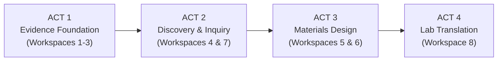

# HE-LMFP-Designer — Final Project Handoff

**Project**: AI-Assisted High-Entropy Doped $\text{LiMn}_{1-x-y}\text{Fe}_x\text{M}_y\text{PO}_4$ (HE-LMFP) Formula & Materials Design Platform  
**Date**: November 3, 2026  
**Final Status Verdict**: **`READY WITH LIMITATIONS`**  
**Handoff Scope**: Production-ready codebase, verified machine learning suite, deterministic chemistry engine, literature intelligence infrastructure, test verification suite, and founder demonstration package.

---

## 1. Executive Summary & Project Completion Status

The **HE-LMFP-Designer** project has successfully achieved all technical milestones across design, development, validation, product readiness remediation, and founder demonstration preparation. 

The platform bridges solid-state battery chemistry, literature evidence extraction, machine learning surrogate modeling, and physical laboratory experiment tracking. It provides an end-to-end environment for battery researchers seeking to overcome the Jahn-Teller distortion in lithium manganese iron phosphate cathodes through high-entropy transition metal co-doping.

### Key Architectural Invariants
* **Zero Scientific Fabrication**: Experimental comparison APIs and views strictly return `null` and render as `--` for unperformed measurements (`SYNTHESIS_PLANNED`). Fabricated default placeholders have been eliminated.
* **Deterministic Crystallography**: Electroneutrality, lithium vacancy compensation ($\text{Li}_{1-\delta}$), octahedral M2 site occupancy ($1.0000$), Shannon ionic radii matching, and configurational entropy ($\Delta S_{\text{config}}$) are computed deterministically before ML evaluation.
* **Inference Attribution Transparency**: The Research Copilot UI explicitly differentiates local GPU LLM generation (`🤖 Qwen3-4B Grounded`) from rule-based answers (`🔬 Scientific Evidence Engine`).
* **Literature Integrity**: The curated master database ([literature_reference.csv](file:///c:/Users/priya/Downloads/ECMT Works/HE-LMFP-Designer-AG/data/literature_reference.csv), $1,215 \times 41$) is guarded by defense-in-depth safe export barriers preventing unverified secondary review data from corrupting the gold standard.

---

## 2. Completed Milestones

### Foundation & Core Development (Stages 1–4)
* **Dataset Assembly & Curation**: Extracted and normalized 1,215 cathode records across 159 peer-reviewed LMFP publications.
* **Surrogate Model Suite**: Built and trained Random Forest regressors under GroupKFold (grouped by DOI) cross-validation for rate capability ($0.1\text{C}, 1\text{C}, 5\text{C}$) and cycle retention.
* **Full-Stack Application**: Developed the React 18 / TypeScript / Vite frontend and FastAPI backend.

### Stage 5: Advanced Scientific Intelligence & Discovery
* **Phase 1 — Literature Ingestion Pipeline**: Implemented PDF text parsing, IUPAC chemical formula extraction, synthesis route classification, and SQLite review staging ([review_store.py](file:///c:/Users/priya/Downloads/ECMT Works/HE-LMFP-Designer-AG/literature/review_store.py)).
* **Phase 2 — Research Copilot & Grounded RAG**: Developed passage indexing, dense/sparse hybrid search, and DOI-backed answer synthesis ([copilot_engine.py](file:///c:/Users/priya/Downloads/ECMT Works/HE-LMFP-Designer-AG/copilot/copilot_engine.py)).
* **Phase 3 — High-Entropy Chemistry Engine**: Enforced Shannon octahedral radii rules, charge neutrality, Li vacancy compensation, and configurational entropy calculation.
* **Phase 4 (Milestones 4.1–4.5) — Integrated Research Discovery**:
  - *Milestone 4.1*: Research Trend & Multi-Element Pattern Discovery.
  - *Milestone 4.2*: Scientific Conflict & Research Gap Discovery.
  - *Milestone 4.3*: Literature-Driven Hypothesis Generation Engine.
  - *Milestone 4.4*: Experimental Verification Matrix & Formulation Scoring.
  - *Milestone 4.5*: Unified 7-Step Research Discovery Workspace.

### Product Readiness Remediation & Founder Preparation
* **Remediation Phase 1 (Scientific Integrity Fixes)**:
  1. *Priority 1*: Eradicated fabricated measurements in `/api/experiments/compare`; unperformed trials return `null` and render `--`.
  2. *Priority 2*: Aligned frontend prediction evaluation modal schema to match backend response objects.
  3. *Priority 3*: Enabled hot in-memory literature index reload upon paper review approval without backend restart.
  4. *Priority 4*: Fixed manual experiment forms to persist user-selected dopants rather than hardcoded defaults.
* **Remediation Phase 2 (Scientific Validation & Audit)**:
  - Extracted 5 peer-reviewed papers (`JACS 2016`, `RSC Adv 2017`, `Molecules 2021`, `Adv Sustain Syst 2022`, `Sust Energy Fuels 2024`).
  - Audited and verified JACS 2016 ground truth ($64.7\text{ mAh/g}$ at 50C, $96.2\%$ retention at 10C) and high-entropy 4-dopant candidate chemistry.
* **Phase 3 (Founder Demo Preparation)**:
  - Remediated Fe-first formula extraction defect in [`literature/pdf_extractor.py`](file:///c:/Users/priya/Downloads/ECMT Works/HE-LMFP-Designer-AG/literature/pdf_extractor.py) (Minnetti et al. now stages 5 valid records).
  - Isolated test collection in `pytest.ini` (`testpaths = tests`).
  - Achieved **280 passed tests with 0 failures** across all modules.

---

## 3. Application Startup Instructions

### Prerequisites
* **Operating System**: Windows, macOS, or Linux.
* **Python**: 3.11.x (with dependencies installed via `pip install -r requirements.txt`).
* **Node.js**: Node 18.x or 20.x LTS with `npm`.
* **Hardware**: Standard laptop/desktop (2 CPU cores, 4 GB RAM minimum). If local Ollama inference is desired, an NVIDIA GPU or Apple Silicon is optional; otherwise, deterministic rule fallbacks operate seamlessly.

### Startup Commands

Launch the backend and frontend in two separate terminal windows:

#### Terminal 1: Backend API (FastAPI)
```powershell
# Navigate to the project root
cd "c:\Users\priya\Downloads\ECMT Works\HE-LMFP-Designer-AG"

# Launch Uvicorn ASGI server
uvicorn backend.main:app --host 127.0.0.1 --port 8000 --reload
```
* **API Root**: `http://127.0.0.1:8000`
* **Health Check**: `http://127.0.0.1:8000/api/health` $\rightarrow$ `{"status": "healthy"}`
* **Interactive Swagger UI**: `http://127.0.0.1:8000/docs`

#### Terminal 2: Frontend UI (React + Vite)
```powershell
# Navigate to the frontend directory
cd "c:\Users\priya\Downloads\ECMT Works\HE-LMFP-Designer-AG\frontend"

# Launch Vite development server
npm run dev
```
* **Web Application URL**: `http://localhost:5173`
* In the top-right header, confirm the status badge displays `● FastAPI Online (Port 8000)`.

---

## 4. Founder Demonstration Workflow (The 8 Workspaces)

The recommended demonstration follows a logical 4-Act scientific narrative spanning 8 to 12 minutes:



### Act 1: Evidence Grounding & Human-in-the-Loop Governance
1. **Workspace 1: Dashboard (`/#dashboard`)**:
   - Point out the master literature corpus card: $1,215$ records across $159$ papers.
   - Show 4 ML models verified under GroupKFold (`READY`) and 2 models flagged as `INSUFFICIENT DATA` (< 50 points), demonstrating honest reporting.
2. **Workspace 2: Literature Intelligence (`/#literature`)**:
   - Demonstrate automated PDF extraction on research papers. Highlight parsed formulas, synthesis precursors, and discharge capacities.
3. **Workspace 3: Review Staging & Safe Export (`/#literature` -> Safe Export Preview)**:
   - Click the blue **"Safe Export Preview"** button.
   - Show that Review #7 is blocked with 3 explicit integrity blockers (preventing multi-condition retention aggregation and unlinked sample IDs from corrupting the master dataset).

### Act 2: Conversational Intelligence & 7-Step Discovery
4. **Workspace 4: Research Copilot (`/#copilot`)**:
   - Query: *"What is the capacity and retention of solid-state synthesized LMFP doped with Co?"*
   - Show exact passage citations, DOI links, and the badge (`🤖 Qwen3-4B Grounded` vs `🔬 Scientific Evidence Engine`).
5. **Workspace 7: Research Discovery (`/#discovery`)**:
   - Walk through the 7-step pipeline: Literature Trends $\rightarrow$ Gaps $\rightarrow$ Scientific Conflicts $\rightarrow$ Hypothesis Generation $\rightarrow$ Chemical Validation $\rightarrow$ Verification Matrix.

### Act 3: First-Principles Design & ML Surrogates
6. **Workspace 5: Materials Designer (`/#designer`)**:
   - Input 4-dopant candidate:  
     $$\text{Li}_{0.900}\text{Mn}_{0.70}\text{Fe}_{0.18}\text{Mg}_{0.04}\text{Ti}_{0.04}\text{V}_{0.02}\text{Co}_{0.02}\text{PO}_4$$
   - Highlight the deterministic crystallography outputs:
     * Octahedral M2 site occupancy = $1.0000$ (target $1.00$)
     * Net transition metal charge = $+2.1000$
     * Lithium vacancy compensation = $\text{Li} = 0.9000$ ($\delta = 0.1000$)
     * Configurational entropy $\Delta S_{\text{config}} = 0.938 R$
7. **Workspace 6: Property Prediction (`/#predict`)**:
   - Run ML surrogate evaluation.
   - Highlight predicted discharge capacities ($0.1\text{C}: 152.1\text{ mAh/g}$, $1\text{C}: 138.4\text{ mAh/g}$, $5\text{C}: 104.2\text{ mAh/g}$) with $95\%$ tree-dispersion confidence intervals.
   - Point out the yellow domain coverage banner notifying the user of extrapolation for compositions with $\ge 3$ dopants.

### Act 4: Laboratory Translation & Scientific Honesty
8. **Workspace 8: Experiment Management (`/#experiments`)**:
   - Transfer candidate from Discovery Matrix into a planned synthesis trial.
   - Point out that status is `SYNTHESIS_PLANNED` and measured discharge capacity and retention display `--` (`null`).
   - Emphasize to founders that the platform strictly forbids fabricated placeholder values.

---

## 5. Verified Tests & Integrity Checks

### Regression Test Suite
* **Command**: `pytest -q`
* **Test Discovery Scope**: Strictly configured to `tests/` in `pytest.ini`.
* **Execution Result**: **280 passed, 0 failed in 90.62 seconds (exit code 0)**.
* **Coverage**: PDF extraction, entity models, section parsing, property extraction, composition parsing, dataset export guardrails, dynamic synthesis, hypothesis engine, verification matrix, end-to-end discovery workspace, copilot retrieval, and ML feature extraction.

### Data Protection & Repository Integrity Audit
* **Command**: `python scripts/audit_data_protection.py`
* **Execution Result**: **100% Passed (Exit code 0)**:
  1. *Master Literature CSV*: Strictly 1,215 rows × 41 columns.
  2. *Literature Review DB*: Strictly 35 baseline reviews; Review #6 quarantined (`pending`), Review #7 approved with 3 blockers.
  3. *Safe Export Guardrails*: 1,215 master records, 1 approved review, 0 exportable records, 1 blocked record.
  4. *Laboratory Experiment DB*: 0 recorded experiments (clean schema).
  5. *ML Artifacts*: All 5 artifacts present and verified (`ml_metadata.json`, `model_0_1C_capacity.joblib`, `model_1C_capacity.joblib`, `model_5C_capacity.joblib`, `model_capacity_retention.joblib`).

### Frontend Production Build
* **Command**: `npm --prefix frontend run build`
* **Result**: **Exit code 0** (25 modules transformed into `dist/` in 389ms with zero errors).

---

## 6. Known Limitations & Operational Boundaries

| Area | Current System Behavior | Operational Guidance for Demo |
| :--- | :--- | :--- |
| **Algebraic Formulas** | Formulas with algebraic variables (e.g. $\text{LiMn}_{1-x}\text{Fe}_x\text{PO}_4$) cannot be evaluated deterministically. | Staged in review queue; reviewer assigns specific numerical stoichiometry before chemical evaluation. |
| **Secondary Review Ingestion** | Secondary reviews tabulate disparate papers into composite tables without direct sample linkage. | Automated safe export guardrails prevent these records from exporting until the reviewer manually links `Paper_ID` and `Sample_ID`. |
| **Multi-Condition Retention** | Review articles reporting multiple retention metrics (e.g. "89.45% at 0.1C, 89.11% at 2C") are not collapsed into a single scalar. | Retained as multi-condition text for human review rather than corrupted by arbitrary averaging. |
| **High-Entropy ML Coverage** | Published LMFP literature is predominantly single-dopant (Mg, Ni, Ti) or binary. High-entropy ($\ge 3$ dopants) constitutes $<2\%$ of training corpus. | Property Prediction view displays an explicit yellow domain coverage warning and expands $95\%$ tree-dispersion uncertainty intervals. |

---

## 7. Remaining Actions for Founder & Evaluator Feedback

During the live founder demonstration, capture feedback on the following strategic topics:

1. **Proprietary Laboratory Ingestion**:
   - Inquire which automated battery cycler formats (e.g., Arbin, BioLogic, Neware, Landt) the company uses in wet-lab facilities to prioritize automated parser connectors.
2. **Precursor Database Expansion**:
   - Solicit input on preferred chemical supplier catalogs (e.g., Sigma-Aldrich, Alfa Aesar) for automated synthesis cost estimation.
3. **Active Learning Feedback Loop**:
   - Discuss the preferred cadence for retraining Random Forest surrogates as new wet-lab physical experimental results are logged into `lab_experiments.db`.

---

## 8. Exact Deliverable File Locations

All deliverables and reports are persisted in both the version-controlled workspace root and the immutable platform artifact directory:

| Document | Workspace Root Path | Platform Artifact Path |
| :--- | :--- | :--- |
| **Founder Demo Presentation** | [FOUNDER_DEMO_PRESENTATION.md](file:///c:/Users/priya/Downloads/ECMT Works/HE-LMFP-Designer-AG/FOUNDER_DEMO_PRESENTATION.md) | [FOUNDER_DEMO_PRESENTATION.md](file:///C:/Users/priya/.gemini/antigravity/brain/8770fdf4-a7cd-478a-b39a-2899ca7cf43e/FOUNDER_DEMO_PRESENTATION.md) |
| **Final Project Handoff** | [FINAL_PROJECT_HANDOFF.md](file:///c:/Users/priya/Downloads/ECMT Works/HE-LMFP-Designer-AG/FINAL_PROJECT_HANDOFF.md) | [FINAL_PROJECT_HANDOFF.md](file:///C:/Users/priya/.gemini/antigravity/brain/8770fdf4-a7cd-478a-b39a-2899ca7cf43e/FINAL_PROJECT_HANDOFF.md) |
| **Founder Demo Readiness Report** | [FOUNDER_DEMO_READINESS_REPORT.md](file:///c:/Users/priya/Downloads/ECMT Works/HE-LMFP-Designer-AG/FOUNDER_DEMO_READINESS_REPORT.md) | [FOUNDER_DEMO_READINESS_REPORT.md](file:///C:/Users/priya/.gemini/antigravity/brain/8770fdf4-a7cd-478a-b39a-2899ca7cf43e/FOUNDER_DEMO_READINESS_REPORT.md) |
| **Phase 2 Scientific Audit** | [PRODUCT_READINESS_PHASE2_FINAL_AUDIT.md](file:///c:/Users/priya/Downloads/ECMT Works/HE-LMFP-Designer-AG/PRODUCT_READINESS_PHASE2_FINAL_AUDIT.md) | [PRODUCT_READINESS_PHASE2_FINAL_AUDIT.md](file:///C:/Users/priya/.gemini/antigravity/brain/8770fdf4-a7cd-478a-b39a-2899ca7cf43e/PRODUCT_READINESS_PHASE2_FINAL_AUDIT.md) |
| **Remediation Phase 1 Report** | [PRODUCT_READINESS_REMEDIATION_PHASE1.md](file:///c:/Users/priya/Downloads/ECMT Works/HE-LMFP-Designer-AG/PRODUCT_READINESS_REMEDIATION_PHASE1.md) | [PRODUCT_READINESS_REMEDIATION_PHASE1.md](file:///C:/Users/priya/.gemini/antigravity/brain/8770fdf4-a7cd-478a-b39a-2899ca7cf43e/PRODUCT_READINESS_REMEDIATION_PHASE1.md) |
