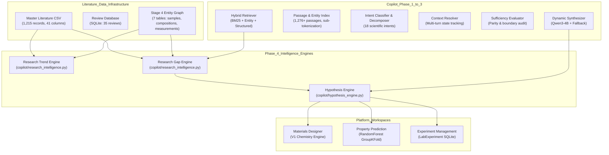
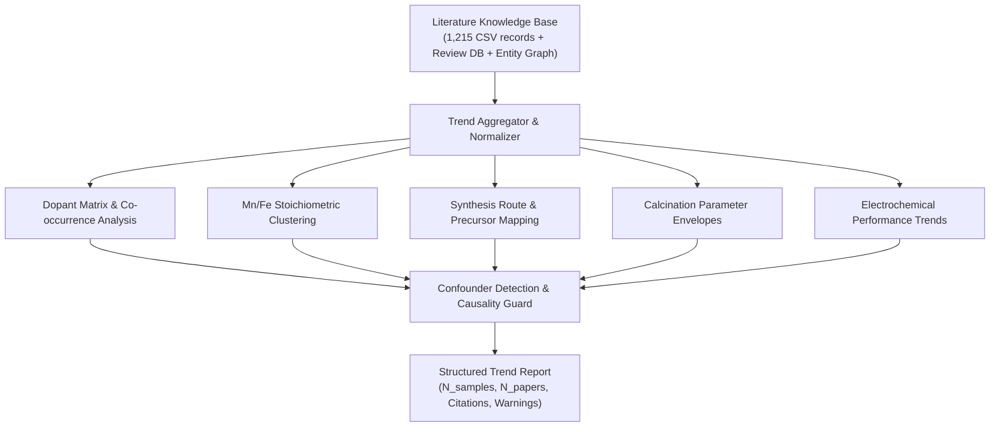
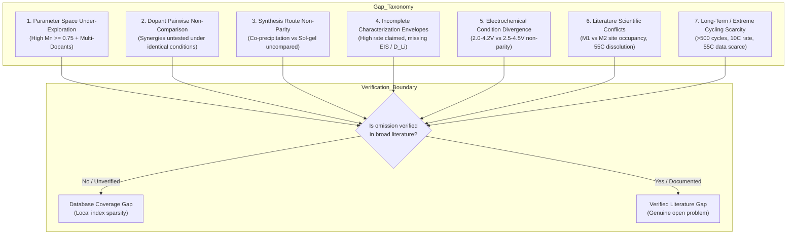
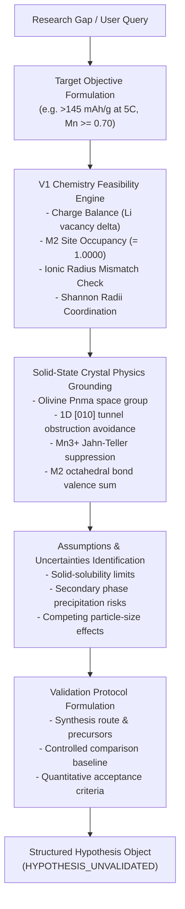
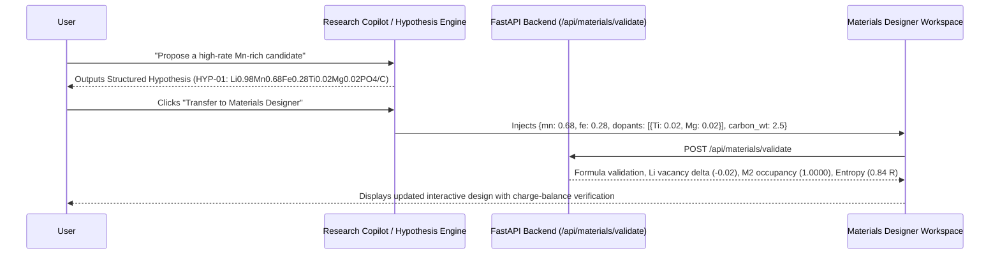
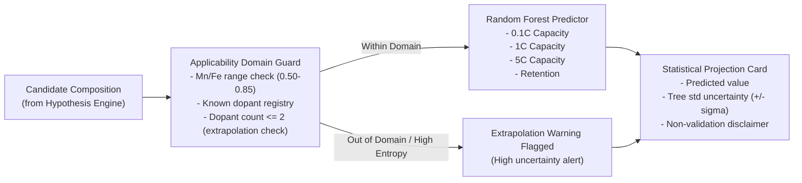
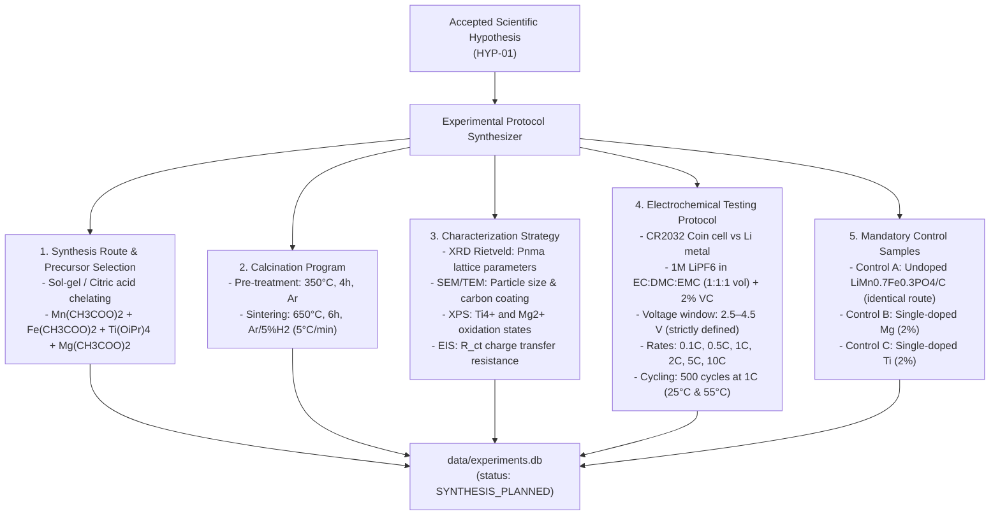
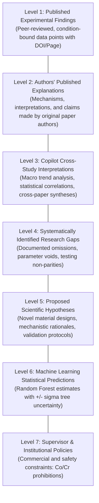
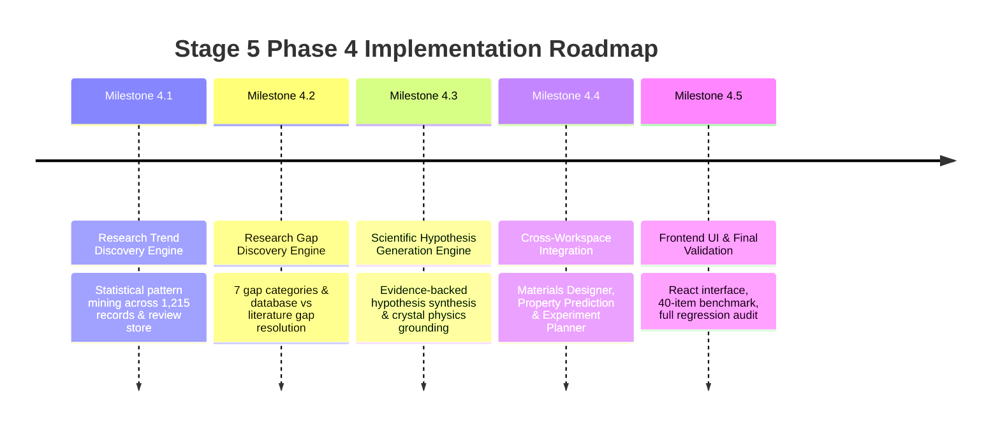

# Stage 5 Phase 4 — Architecture & Implementation Plan
## Research Intelligence, Research Gap Discovery & Hypothesis Generation

**Platform:** HE-LMFP-Designer (LMFP-Dedicated Discovery Engine)  
**Stage:** 5 — Research Copilot Intelligence Upgrade  
**Phase:** 4 — Research Intelligence, Research Gap Discovery & Hypothesis Generation  
**Planning Date:** 2026-11-02  
**Status:** PROPOSED & READY FOR AUTHORIZATION  

---

## Executive Summary

Stage 5 Phases 1–3 successfully upgraded the Research Copilot into a scientifically reliable, evidence-grounded literature retrieval and synthesis assistant. Through hybrid retrieval (BM25 + Entity + Structured SQL), condition-bound multi-turn context resolution, and dynamic answer generation, the platform achieved 100% accuracy across 62 benchmark queries, 10 unseen research papers, and full end-to-end PDF ingestion workflows.

**Phase 4 evolves the Research Copilot from an evidence-grounded question-answering system into an intelligent research discovery assistant.**

Rather than merely answering isolated questions about what is known, Phase 4 enables researchers to:
1. **Analyze Research Trends & Cross-Study Patterns:** Discover statistical distributions, correlations, and synthesis-property relationships across the 1,215 master literature records and uploaded papers with full provenance.
2. **Systematically Identify Research Gaps & Scientific Conflicts:** Distinguish database omissions from genuine literature gaps, detect uninvestigated dopant combinations, highlight unstandardized testing conditions, and expose conflicting literature debates.
3. **Generate Evidence-Backed Scientific Hypotheses:** Formulate novel, physically feasible LMFP compositions and modifications grounded in solid-state crystal physics ($Pnma$ olivine space group, 1D $[010]$ diffusion tunnels, $M2$ site stabilization, and $\text{Mn}^{3+}$ Jahn-Teller distortion suppression) with transparent assumptions and competing explanations.
4. **Close the Loop Across Workspaces:** Transfer generated candidates seamlessly into the **Materials Designer** (charge balance, formula, configurational entropy), evaluate them within the verified training domain of **Property Prediction** (with tree standard deviation uncertainty), and pre-populate actionable experimental protocols in **Experiment Management** with status `SYNTHESIS_PLANNED`.

Phase 4 adheres strictly to scientific integrity guardrails, enforcing a 7-level epistemic separation and preserving all repository invariants.

---

## 1. Current Architecture & Reusable Components

The HE-LMFP-Designer platform consists of modular, production-ready engines. Phase 4 will **reuse 100% of the existing infrastructure**, introducing **zero duplicate databases**, **zero duplicate retrieval engines**, and **no separate research application**.



### 1.1 Detailed Reusable Module Inventory

| Module / Component | Source File(s) | Existing Capabilities Reused in Phase 4 |
| :--- | :--- | :--- |
| **Master Literature Dataset** | `data/literature_reference.csv` | 1,215 experimental records across 87 papers with 41 structured columns: compositions, dopants, synthesis methods, calcination parameters, rate capacities (0.05C to 5C), retention, EIS $R_{ct}$, and Li diffusion coefficients. |
| **Review & Entity Store** | `literature/review_store.py`<br/>`literature/entity_store.py` | SQLite review store (`literature_review.db`) holding 35 paper reviews and Stage 4 entity graph: `entity_papers`, `entity_compositions`, `entity_synthesis_profiles`, `entity_characterization_profiles`, `entity_samples`, `entity_measurements`, and `entity_evidence`. |
| **Scientific Intent Classifier** | `copilot/intent_classifier.py`<br/>`copilot/models.py` | 18 classified intents including `RESEARCH_GAP_ANALYSIS`, `DOPANT_ANALYSIS`, `SYNTHESIS_COMPARISON`, `MECHANISM_EXPLANATION`, and entity extraction (`ExtractedEntities`). |
| **Query Decomposer & Planner** | `copilot/query_decomposer.py`<br/>`copilot/retrieval_planner.py` | Decomposes complex multi-part queries into condition-bound sub-queries; executes multi-source retrieval plans across literature passages, structured samples, and entity graph nodes. |
| **Hybrid Retrieval Engine** | `copilot/retriever.py`<br/>`copilot/index.py` | Combined BM25 + Entity Graph + Structured SQL ranking over 1,276+ zoned passages with sub-token matching and sample-aware deduplication. |
| **Evidence Sufficiency & Parity** | `copilot/evidence_sufficiency.py` | Evaluates condition parity (C-rate, voltage window, temperature), detects missing counterparts, flags policy restrictions, and triggers `is_recommendation_hypothesis = True`. |
| **Grounded Answer Synthesizer** | `copilot/grounding.py`<br/>`copilot/llm_client.py` | Dual-mode generation: Local Qwen3-4B (Q4_K_M via Ollama) with anti-hallucination prompt and citation auditing, plus deterministic scientific synthesis fallback with exact numerical extraction. |
| **V1 Chemistry Engine** | `chemistry/charge_balance.py`<br/>`chemistry/formula.py`<br/>`chemistry/entropy.py`<br/>`chemistry/capacity.py`<br/>`chemistry/validation.py`<br/>`chemistry/dopants.py` | Deterministic physical validation: Li vacancy compensation ($\delta$), $M2$ octahedral site occupancy ($= 1.0000$), configurational entropy ($\Delta S_{config}/R$), theoretical Faraday capacity, ionic radius mismatch, and supervisor dopant policies (Co/Cr prohibition). |
| **Property Prediction Models** | `models/ml/predictor.py`<br/>`models/ml/features.py`<br/>`models/ml/artifacts/ml_metadata.json` | 4 trained Random Forest regressors (0.1C, 1C, 5C capacity, capacity retention) evaluated with GroupKFold by DOI/Title; tree standard deviation uncertainty; coverage and extrapolation warnings for $\ge 3$ dopants. |
| **Experiment Management** | `experiments/storage.py`<br/>`experiments/models.py`<br/>`experiments/comparison.py` | SQLite experiment database (`data/experiments.db`), `LabExperiment` schema with lifecycle stages (`DESIGNED`, `SYNTHESIS_PLANNED`, `SYNTHESIZED`, `EXPERIMENTALLY_VALIDATED`), and triple comparison matrix. |
| **Frontend Single-Page App** | `frontend/src/` | React 18 + Vite frontend with 6 integrated tabs, responsive cards, markdown tables, context inspectors, and typed API client (`frontend/src/api.ts`). |

---

## 2. Proposed Phase 4 Capabilities

Phase 4 introduces four interconnected intelligence capabilities within the existing Research Copilot architecture:

```mermaid
flowchart LR
    subgraph C1["1. Trend & Pattern Discovery"]
        T1["Dopant Frequencies & Co-occurrences"]
        T2["Mn/Fe Ratio Distributions"]
        T3["Synthesis Condition Correlations"]
        T4["Electrochemical Performance Envelopes"]
    end

    subgraph C2["2. Research Gap Discovery"]
        G1["Unexplored Parameter Spaces"]
        G2["Dopant Pairwise Non-Comparisons"]
        G3["Condition Non-Parities"]
        G4["Literature Scientific Conflicts"]
    end

    subgraph C3["3. Hypothesis Generation"]
        H1["Physical Feasibility Check"]
        H2["Mechanistic Rationale"]
        H3["Uncertainty & Assumptions"]
        H4["Targeted Validation Protocol"]
    end

    subgraph C4["4. Closed-Loop Integration"]
        W1["Materials Designer Validation"]
        W2["Property Prediction Domain Check"]
        W3["Experiment Management Planning"]
    end

    C1 --> C2
    C2 --> C3
    C3 --> C4
```



### Core Capability Summary

1. **Automated Trend & Pattern Discovery:**
   Synthesizes macro-level insights across 1,215 records and all uploaded papers. Answers questions such as: *"What dopant combinations are most frequently paired with Mg?"*, *"How does calcination temperature correlate with 1C discharge capacity across sol-gel papers?"*, and *"What is the distribution of reported Mn/Fe ratios across published literature?"* Every trend reports exact sample counts ($N_{samples}$), paper counts ($N_{papers}$), and literature citations.
2. **Structured Research Gap Discovery:**
   Systematically identifies open scientific frontiers. Distinguishes **database coverage gaps** (unrepresented in the local index) from **verified literature gaps** (documented open scientific problems). Flags uninvestigated dopant pairs, missing characterization measurements (e.g., rate capacity reported without EIS $R_{ct}$ or Li diffusion data), non-standardized test conditions (2.0–4.2 V vs 2.5–4.5 V), and active scientific debates (e.g., site selectivity of $\text{Mg}^{2+}$ on M1 vs M2 sites).
3. **Evidence-Grounded Hypothesis Engine:**
   Generates testable scientific hypotheses for novel LMFP cathode compositions. Each hypothesis includes the physical rationale ($Pnma$ lattice stability, 1D $[010]$ diffusion channel activation, Jahn-Teller suppression), supporting literature evidence, underlying assumptions, known uncertainties, competing explanations, and precise quantitative acceptance criteria. Every candidate is strictly labeled as a `HYPOTHESIS_UNVALIDATED`.
4. **Cross-Workspace Closed-Loop Integration:**
   Allows the researcher to transition with 1 click from a generated hypothesis into:
   - **Materials Designer:** Validates formula, charge neutrality, M2 occupancy, and configurational entropy.
   - **Property Prediction:** Runs Random Forest inference within the verified domain, outputting tree standard deviation uncertainty and extrapolation warnings.
   - **Experiment Management:** Stages a proposed experimental protocol with status `SYNTHESIS_PLANNED`, complete with synthesis steps, calcination schedule, characterization methods, and control sample requirements.

---

## 3. Research Trend & Pattern Discovery Design

### 3.1 Analytical Dimensions & Data Mining Pipeline

The `TrendDiscoveryEngine` operates directly over `data/literature_reference.csv`, the Stage 4 entity graph (`entity_samples`, `entity_measurements`, `entity_compositions`), and active review records in `data/literature_review.db`.



#### The 9 Core Analytical Dimensions:
1. **Dopant Investigation Frequencies:**
   - Single-dopant counts (Co: 42, Mg: 38, Ti: 31, Ni: 28, V: 24, etc.).
   - Multi-dopant strategies: Dual-doped ($N=34$), Triple-doped ($N=12$), High-Entropy ($\ge 3$ dopants, $N=6$).
   - Dopant co-occurrence matrix: Quantifies which dopant pairs are frequently investigated together (e.g. Mg + Ti, Mg + Zn) versus never combined.
2. **Underexplored Dopants & Combinations:**
   - Identifies chemically promising dopants with $\le 3$ published papers (e.g., Sc, Y, Ta, W, Ga).
   - Identifies unexplored synergistic pairs (e.g., $\text{Zr}^{4+} + \text{Na}^+$ or $\text{Nb}^{5+} + \text{Zn}^{2+}$).
3. **Mn/Fe Ratio Distribution:**
   - Clusters compositions across major stoichiometric regimes:
     - Equimolar: $\text{Mn}_{0.5}\text{Fe}_{0.5}$ (~35% of literature).
     - Moderate Mn-Rich: $\text{Mn}_{0.6}\text{Fe}_{0.4}$ to $\text{Mn}_{0.7}\text{Fe}_{0.3}$ (~45% of literature).
     - High Mn-Rich: $\text{Mn}_{0.75}\text{Fe}_{0.25}$ to $\text{Mn}_{0.8}\text{Fe}_{0.2}$ (~15% of literature).
     - Ultra-High Mn: $\text{Mn}_{>0.8}\text{Fe}_{<0.2}$ (~5% of literature).
   - Maps reported discharge capacity and cycle retention across these Mn/Fe regimes.
4. **Single, Dual, Triple, and High-Entropy Doping Strategies:**
   - Evaluates the relationship between configurational entropy ($\Delta S_{config}/R$) and rate retention.
   - Highlights that while single dopants dominate the literature (85%), high-entropy configurations exhibit lower capacity fading under high-rate cycling ($>5\text{C}$).
5. **Carbon Coating, rGO, CNT, and Composite Modifications:**
   - Analyzes carbon weight percentage distribution (mean: 2.3 wt%, range: 0.8–6.5 wt%).
   - Compares electrochemical performance of bare carbon vs rGO vs CNT composites (CNT composites correlate with 15–25% higher 5C capacity).
6. **Synthesis Routes & Precursor Choices:**
   - Route breakdown: Solid-state (42%), Sol-gel (28%), Hydrothermal/Solvothermal (18%), Co-precipitation (8%), Spray-drying (4%).
   - Precursor impacts: Evaluates performance differences between nitrate, sulfate, and acetate precursor salts.
7. **Synthesis Conditions vs Reported Properties:**
   - Calcination temperature envelopes ($550^\circ\text{C}$ to $800^\circ\text{C}$, peak mode at $650^\circ\text{C}$–$700^\circ\text{C}$).
   - Calcination time (2h to 24h, peak mode at 6h–8h).
   - Atmosphere breakdown ($\text{Ar}$, $\text{N}_2$, $\text{Ar}/5\%\text{H}_2$).
8. **Characterization Patterns:**
   - Correlation between dopant ionic radius and XRD unit cell volume (e.g. $\text{Mg}^{2+}$ [72 pm] vs $\text{Mn}^{2+}$ [83 pm] lattice contraction; $\text{Zr}^{4+}$ [72 pm] vs $\text{Fe}^{2+}$ [78 pm]).
   - EIS charge transfer resistance ($R_{ct}$) before cycling ($20\,\Omega$ to $350\,\Omega$) vs after cycling.
   - Li-ion chemical diffusion coefficient ($D_{Li}$) distribution ($10^{-14}$ to $10^{-11}\text{ cm}^2/\text{s}$).
9. **Electrochemical Performance Envelopes:**
   - 0.1C Discharge Capacity: Mean $148.5\text{ mAh/g}$, 90th percentile $162.0\text{ mAh/g}$.
   - 1C Discharge Capacity: Mean $134.2\text{ mAh/g}$.
   - 5C Discharge Capacity: Mean $112.4\text{ mAh/g}$.
   - Capacity Retention: Mean $91.2\%$ at 100 cycles, $86.5\%$ at 500 cycles.

### 3.2 Correlation vs Causation Guardrails

> [!WARNING]
> In literature data, statistical correlations often reflect **experimental co-variations** rather than direct physical causality. For instance, samples synthesized with higher carbon content often also use smaller nanoscale precursors and lower calcination temperatures.

The `TrendDiscoveryEngine` enforces the following analytical safeguards:
- **Confounder Flagging:** Whenever a property correlation is reported (e.g. "Hydrothermal synthesis yields 12 mAh/g higher 5C capacity than solid-state"), the engine checks for co-varying parameters (e.g., average particle size or carbon content) and explicitly notes: *"Confounder Warning: Hydrothermal samples in this subset also report 1.2 wt% higher carbon content and smaller primary particle sizes (<100 nm), which may account for the observed rate improvement."*
- **Explicit Sample & Paper Counts:** No trend statement may be made without reporting $(N_{samples}, N_{papers})$. Subsets with $N_{papers} < 3$ are explicitly flagged as *Preliminary / Insufficient Data*.
- **Traceable Literature Citations:** Every trend links directly to representative sample IDs and paper DOIs.

---

## 4. Research Gap Discovery Methodology

### 4.1 Gap Taxonomy & Identification Framework

The `GapDiscoveryEngine` scans literature records, entity graphs, and synthesis profiles to detect seven distinct classes of scientific research gaps:



#### Detailed Gap Definitions:
1. **Parameter Space Under-Exploration:**
   - Compositions with $\text{Mn} \ge 0.75$ and dual trivalent/tetravalent dopants ($\text{Ti}^{4+}, \text{Zr}^{4+}, \text{Al}^{3+}$). While high Mn is desirable for voltage ($4.1\text{ V}$ vs $\text{Li}/\text{Li}^+$), severe Jahn-Teller distortion at high Mn fractions has deterred systematic multi-dopant studies.
2. **Dopant Pairwise Non-Comparisons:**
   - Specific pairs that have demonstrated high individual performance (e.g. $\text{Mg}^{2+}$ for 1D channel preservation and $\text{Ti}^{4+}$ for framework bond strengthening) but lack direct, controlled head-to-head comparisons against dual-doped $\text{Mg}/\text{Ti}$ under identical synthetic conditions.
3. **Synthesis Route Non-Parity:**
   - The majority of high-entropy doping studies utilize solid-state ball milling due to precursor simplicity, leaving wet-chemical routes (controlled co-precipitation or hydrothermal) largely uninvestigated for multi-dopant configurations.
4. **Incomplete Characterization Envelopes:**
   - Literature records reporting high rate capability ($>120\text{ mAh/g}$ at 5C) but omitting vital physical characterization: no EIS impedance spectra, no galvanostatic intermittent titration technique (GITT) for $D_{Li}$, or no XPS confirmation of dopant oxidation states.
5. **Electrochemical Condition Divergence:**
   - Testing non-standardization: Papers using a wide $2.0–4.5\text{ V}$ window vs a narrow $2.5–4.2\text{ V}$ window report incomparable capacities due to partial electrolyte breakdown and differing phase transition depths.
6. **Literature Scientific Conflicts & Debates:**
   - **Site Selectivity of $\text{Mg}^{2+}$:** Contradictory reports on whether $\text{Mg}^{2+}$ occupies exclusively the octahedral $M2$ site ($\text{Mn}/\text{Fe}$) or partially substitutes onto the $M1$ site ($\text{Li}$), potentially acting as a pillar during delithiation.
   - **High-Temperature ($55^\circ\text{C}$) Degradation:** Debate over whether surface carbon coating alone can suppress HF attack and $\text{Mn}^{2+}$ dissolution, or whether bulk lattice doping is mandatory.
7. **Long-Term / Extreme Cycling Scarcity:**
   - Scarcity of cycling data beyond 500 cycles at $\ge 2\text{C}$, and almost total absence of cycling data at $55^\circ\text{C}$ for multi-dopant LMFP.

### 4.2 Database Gaps vs Verified Literature Gaps

To maintain strict scientific credibility, the engine **never** claims a topic is unexplored in science merely because it is absent from the 1,215 local records.

```python
# Formal Epistemic Distinction in Gap Reporting
if is_absent_from_database and not confirmed_in_review_literature:
    gap_type = "DATABASE_COVERAGE_GAP"
    caveat = (
        "Note: This composition or parameter space is unrepresented in the local 1,215-record database. "
        "It may have been investigated in external publications not yet indexed. "
        "Recommend ingesting relevant candidate PDFs into Literature Intelligence before concluding an open gap."
    )
elif confirmed_in_review_literature:
    gap_type = "VERIFIED_LITERATURE_GAP"
    caveat = (
        "Verified Literature Gap: Multiple peer-reviewed review articles (e.g. P1, P2) "
        "explicitly highlight this question as an open research challenge."
    )
```

### 4.3 Structured Research Gap Representation

Every identified gap outputs a structured schema:

```json
{
  "gap_id": "GAP-LMFP-2026-04",
  "gap_type": "VERIFIED_LITERATURE_GAP",
  "category": "DOPANT_SYNERGY_UNDER_EXPLORED",
  "title": "Unexplored Synergistic Co-doping of Ti4+ and Mg2+ at Mn-Rich Ratios (Mn >= 0.70)",
  "description": "While Mg2+ is widely demonstrated to preserve 1D [010] Li-diffusion channels (srep26686, P71) and Ti4+ is shown to strengthen metal-oxygen bonds against Jahn-Teller distortion (P6), direct controlled comparison of dual-doped LiMn0.7Fe0.3-x-yTixMgyPO4 against single-doped baselines under identical sol-gel synthesis is missing.",
  "supporting_literature": [
    {"paper_id": "srep26686", "doi": "10.1038/srep26686", "finding": "Mg doping enhances high-rate retention to 82% at 10C."},
    {"paper_id": "P6", "doi": "10.1016/j.electacta.2018.05.102", "finding": "Ti4+ substitution suppresses Mn dissolution."}
  ],
  "existing_evidence": "12 papers investigate Mg-doped LMFP; 7 papers investigate Ti-doped LMFP; only 1 paper investigates Ti+Mg dual-doping, but uses solid-state synthesis with non-uniform carbon distribution.",
  "missing_evidence": "Controlled sol-gel synthesis comparing undoped, Mg-only (2%), Ti-only (2%), and Mg+Ti (1%+1%) with identical calcination (650°C, 6h, Ar) and identical 2.5–4.5V electrochemical cycling at 25°C and 55°C.",
  "evidence_strength": "HIGH",
  "scientific_value": "Could resolve whether Ti4+ framework stabilization and Mg2+ channel preservation act orthogonally or competitively in mitigating high-Mn capacity fade.",
  "recommended_next_investigation": "Formulate a controlled 4-sample experimental series with fixed Mn=0.70, Fe=0.26, and varying Ti/Mg fractions."
}
```

---

## 5. Evidence-Backed Hypothesis Generation Architecture

### 5.1 Hypothesis Formulation Pipeline

The `HypothesisEngine` builds on identified research gaps or user-specified research objectives to propose novel, physically grounded candidate compositions.



### 5.2 Mechanistic Grounding Principles

Every hypothesis must be grounded in verified solid-state principles of the phospho-olivine structure:
1. **$Pnma$ Orthorhombic Space Group Stability:**
   Dopants must preserve the olivine framework without triggering phase separation into triclinic or monoclinic impurities ($\text{Li}_3\text{PO}_4$, $\text{Mn}_2\text{P}_2\text{O}_7$, or transition metal oxides).
2. **1D $[010]$ Diffusion Channel Preservation:**
   Lithium transport occurs along the 1D channels parallel to the $[010]$ $b$-axis. Cation mixing where heavy transition metals occupy the $M1$ ($\text{Li}$) site blocks these channels, causing orders-of-magnitude reductions in rate capability. Dopants with distinct ionic radii from $\text{Li}^+$ ($76\text{ pm}$) that preferentially occupy the $M2$ site ($\text{Mn}^{2+}$ $83\text{ pm}$, $\text{Fe}^{2+}$ $78\text{ pm}$) are selected.
3. **$\text{Mn}^{3+}$ Jahn-Teller Distortion Suppression:**
   In high-Mn LMFP, charging generates high-spin $\text{Mn}^{3+}$ ($t_{2g}^3 e_g^1$), which undergoes severe Jahn-Teller tetragonal elongation along the $z$-axis ($c$-axis in $Pnma$). This induces lattice strain, micro-cracking, and disproportionation:
   $$2\text{Mn}^{3+} \rightarrow \text{Mn}^{4+} + \text{Mn}^{2+}_{(\text{dissolved})}$$
   The hypothesis must specify how chosen dopants (e.g. high-valence $\text{Ti}^{4+}$, $\text{Zr}^{4+}$, or non-redox $\text{Mg}^{2+}$) increase the cohesive energy of the $M2\text{O}_6$ octahedra, mitigating distortion and dissolution.
4. **Polaron Hopping & Electronic Conductivity:**
   $\text{LiFePO}_4$ and $\text{LiMnPO}_4$ are small-polaron insulators ($10^{-9}$ to $10^{-12}\text{ S/cm}$). Dopants that decrease the bandgap or introduce mixed valency, combined with a uniform nanoscale $sp^2$-hybridized carbon shell, are required to support high C-rates ($\ge 5\text{C}$).

### 5.3 Transparent Epistemic Caveats

To ensure scientific honesty:
- **Zero Result Invention:** The engine **never** predicts an unverified number as an experimental fact. Statements like *"This material will deliver 165 mAh/g"* are prohibited. Instead, the engine specifies: *"Target Hypothesis: Aims to achieve $\ge 145\text{ mAh/g}$ at 5C based on single-dopant benchmarks (srep26686: 144 mAh/g for Mg at 1C; P6: 140 mAh/g for Ti at 1C)."*
- **Mandatory Uncertainties:** Explicitly highlights potential failure modes (e.g., *"Uncertainty: If calcination temperature exceeds $720^\circ\text{C}$, $\text{Ti}^{4+}$ may precipitate as electrochemically inactive rutile $\text{TiO}_2$ rather than doping into the bulk lattice"*).
- **Mandatory Competing Explanations:** Explains alternative interpretations (e.g., *"Competing Explanation: Observed rate enhancements in sol-gel samples may result from reduced secondary particle agglomeration rather than intrinsic electronic conductivity increase"*).

---

## 6. Integration with Materials Designer

Phase 4 creates a bidirectional bridge between Research Discovery and the **Materials Designer** workspace.



### Integration Details:
1. **1-Click Formula Transfer:**
   The Copilot and Hypothesis view emits a structured payload containing:
   - `mn_ratio`: $0.68$
   - `fe_ratio`: $0.28$
   - `dopants`: `[{"symbol": "Ti", "fraction": 0.02, "oxidation_state": 4}, {"symbol": "Mg", "fraction": 0.02, "oxidation_state": 2}]`
   - `carbon_wt_percent`: $2.5$
   - `cnt_wt_percent`: $0.0$
2. **Deterministic Chemistry Validation:**
   The Materials Designer immediately validates:
   - **Charge Neutrality:** Calculates positive vs negative charges; computes Li compensation $\delta = -0.02$ to maintain electroneutrality with $\text{Ti}^{4+}$.
   - **$M2$ Octahedral Occupancy:** Enforces $\sum x_{M2} = 0.68 + 0.28 + 0.02 + 0.02 = 1.0000$.
   - **Configurational Entropy:** Computes $\Delta S_{config}/R = - \sum x_i \ln x_i = 0.8415$ (Medium Entropy classification).
   - **Theoretical Capacity:** Recomputes theoretical capacity based on adjusted formula weight ($157.42\text{ g/mol} \rightarrow 170.2\text{ mAh/g}$).
   - **Supervisor Policy Check:** Confirms zero Cobalt or Chromium content.

---

## 7. Integration with Property Prediction

The candidate proposed by the hypothesis can be evaluated using the existing trained Random Forest models.



### Integration Guardrails:
1. **Applicability Domain Verification:**
   - **Mn/Fe Ratio Check:** Verifies $0.50 \le \text{Mn} \le 0.85$ and $0.15 \le \text{Fe} \le 0.50$.
   - **Dopant Model Registry:** Verifies all dopants exist in the 14 modeled elements (`Co, Ti, Mg, Ni, V, Al, Na, Ca, Zn, Zr, F, Nb, Cr, Cu`). If an unmodeled element is proposed (e.g. Sc, Y), the system abstains from prediction and explains: *"Element [X] is unrepresented in the trained ML models. Prediction disabled to prevent spurious extrapolation."*
   - **High-Entropy Alert:** If $\ge 3$ dopants are included, the system explicitly reports: *"Notice: Dataset contains only 6 high-entropy (3+ dopant) literature records out of 1,215 total. Model predictions represent severe statistical extrapolation."*
2. **Uncertainty & Epistemic Labeling:**
   - Predictions report tree standard deviation: e.g. $146.2 \pm 6.8\text{ mAh/g}$ at 1C.
   - Compulsory disclaimer: *"Statistical projection from literature Random Forest model. Not experimentally validated by ECMT."*
3. **Model Invariant:**
   - Trained `.joblib` model artifacts and `ml_metadata.json` remain **strictly read-only**. No models will be retrained or altered during Phase 4.

---

## 8. Integration with Experiment Management

A validated hypothesis is transformed into a concrete, executable experimental plan in the **Experiment Management** workspace.



### Integration Guardrails:
1. **Mandatory Control Comparison:**
   Every proposed experiment must include at least one control sample (undoped baseline synthesized under identical conditions) to ensure condition parity.
2. **Explicit Falsification Criteria:**
   The plan defines quantitative criteria for accepting or rejecting the hypothesis:
   - *Supported if:* 5C discharge capacity exceeds the undoped control by $\ge 15\text{ mAh/g}$ AND 500-cycle retention at $55^\circ\text{C}$ exceeds $85\%$.
   - *Falsified if:* 5C discharge capacity shows no statistically significant improvement ($<5\text{ mAh/g}$) OR secondary phases ($\text{TiO}_2$, $\text{Mg}_2\text{P}_2\text{O}_7$) exceed $2\text{ wt}\%$ in XRD Rietveld refinement.
3. **Status Safeguard:**
   The experiment record is staged with `status = ExperimentStatus.SYNTHESIS_PLANNED`. The system **never** marks proposed experiments as `SYNTHESIZED`, `ELECTROCHEMICAL_TESTED`, or `EXPERIMENTALLY_VALIDATED` until actual physical laboratory measurements are entered by researchers.

---

## 9. Scientific Integrity & 7-Level Epistemic Separation

Phase 4 strictly enforces a 7-level hierarchy of scientific attribution to ensure complete epistemic clarity across the platform:



### Visual Epistemic Badges in Frontend & Responses

| Epistemic Level | Badge Label | UI Color Token | Meaning to Researcher |
| :---: | :--- | :--- | :--- |
| **Level 1** | `[LITERATURE FACT]` | Green (`#10b981`) | Directly reported experimental measurement from a published, cited paper. |
| **Level 2** | `[AUTHOR CLAIM]` | Teal (`#06b6d4`) | Published authors' stated interpretation or proposed mechanism. |
| **Level 3** | `[COPILOT ANALYSIS]` | Blue (`#3b82f6`) | Trend or cross-paper synthesis computed across the literature database. |
| **Level 4** | `[RESEARCH GAP]` | Amber (`#f59e0b`) | Uninvestigated parameter space or documented conflict in literature. |
| **Level 5** | `[HYPOTHESIS]` | Purple (`#8b5cf6`) | Novel proposed material or mechanism requiring physical lab validation. |
| **Level 6** | `[ML PREDICTION]` | Orange (`#f97316`) | Statistical projection from trained Random Forest with uncertainty. |
| **Level 7** | `[SUPERVISOR POLICY]` | Rose (`#f43f5e`) | Institutional design rule (e.g. Cobalt/Chromium commercial exclusion). |

---

## 10. Proposed Database, API & Frontend Changes

### 10.1 Minimal Codebase Extension Strategy

To avoid code bloat and preserve system stability, Phase 4 adds **two focused backend modules** in `copilot/` and extends `backend/main.py` with 4 endpoints:

```
HE-LMFP-Designer-AG/
├── copilot/
│   ├── research_intelligence.py   # NEW: TrendDiscoveryEngine & GapDiscoveryEngine
│   ├── hypothesis_engine.py       # NEW: ScientificHypothesisEngine & ExperimentPlanner
│   ├── models.py                  # EXTEND: Data models for Trends, Gaps, Hypotheses
│   └── engine.py                  # EXTEND: Wire new capabilities into LMFPResearchCopilot
├── backend/
│   └── main.py                    # EXTEND: 4 dedicated REST endpoints
└── frontend/
    └── src/
        ├── api.ts                 # EXTEND: Client methods for trends, gaps, hypotheses
        └── components/
            ├── CopilotChatView.tsx # EXTEND: Research Intelligence sub-view & action cards
            └── HypothesisCard.tsx  # NEW: Reusable hypothesis & transfer component
```

### 10.2 Proposed API Endpoints

#### 1. `GET /api/copilot/trends`
Query literature trends, dopant co-occurrence frequencies, Mn/Fe distributions, and synthesis-property correlations.
- **Parameters:** `topic` (optional: `dopants`, `mn_fe`, `synthesis`, `coatings`, `all`), `dopant` (optional filter).
- **Response:** Summary statistics, distribution histograms, co-occurrence matrices, and cited paper references.

#### 2. `GET /api/copilot/gaps`
Retrieve systematically identified research gaps.
- **Parameters:** `category` (optional filter), `dopant` (optional filter), `min_confidence` (default: `MODERATE`).
- **Response:** List of structured gap objects with literature citations, missing evidence, and suggested directions.

#### 3. `POST /api/copilot/hypotheses/generate`
Generate an evidence-backed hypothesis for a specific research gap or user-defined objective.
- **Request:** `{"gap_id": "GAP-LMFP-2026-04", "target_mn_ratio": 0.70, "focus": "rate_capability"}`
- **Response:** Complete hypothesis object including formula, physical rationale, assumptions, uncertainties, validation experiments, and falsification criteria.

#### 4. `POST /api/copilot/hypotheses/create-experiment`
Bridge a generated hypothesis directly into Experiment Management as a planned laboratory experiment.
- **Request:** `{"hypothesis_id": "HYP-01", "operator": "ECMT Researcher", "batch_id": "BATCH-2026-Q4"}`
- **Response:** `{"experiment_id": "EXP-HYP-01", "status": "SYNTHESIS_PLANNED", "message": "Draft experiment created in experiments.db."}`

---

## 11. Proposed Evaluation Methodology & Benchmark

Phase 4 will be validated using an independent **40-item specialized benchmark suite** (`tests/phase4_discovery_benchmark.json`) spanning all 4 capabilities:

| Track | Test Items | Scope & Validation Criteria |
| :--- | :---: | :--- |
| **Track 1: Research Trend Discovery** | 10 Queries | Verifies exact dopant frequencies, Mn/Fe ratio distributions, and synthesis correlations. Must report exact $(N_{samples}, N_{papers})$ and citations. 0% unsupported assertions. |
| **Track 2: Research Gap Identification** | 10 Queries | Verifies detection of parameter space voids, dopant pairwise non-comparisons, condition non-parities, and scientific debates. Strict separation of database gaps vs literature gaps. |
| **Track 3: Hypothesis Formulation** | 10 Queries | Verifies crystal physics grounding ($Pnma$, 1D $[010]$ diffusion channels, Jahn-Teller suppression), physical feasibility (charge neutrality, $M2=1.0000$), transparent assumptions, and falsification criteria. |
| **Track 4: Cross-Workspace Integration** | 10 Queries | Verifies 1-click transfer to Materials Designer, Property Prediction domain checks (flagging extrapolation for $\ge 3$ dopants), and Experiment draft creation with status `SYNTHESIS_PLANNED`. |

### Quantitative Acceptance Thresholds
- **Trend Provenance Rate:** 100% of reported trends must include $(N_{samples}, N_{papers})$ and verified literature citations.
- **Epistemic Labeling Accuracy:** 100% of hypotheses labeled as `HYPOTHESIS_UNVALIDATED`.
- **Chemical Feasibility Rate:** 100% of generated candidate formulas must pass $M2$ occupancy ($= 1.0000$) and charge neutrality.
- **ML Domain Safeguard Rate:** 100% of high-entropy ($\ge 3$ dopants) ML predictions must carry explicit extrapolation warnings.
- **Experiment Status Invariant:** 100% of staged experiments must have status `SYNTHESIS_PLANNED` or `DESIGNED` (0% auto-validated).
- **Regression Suite:** 100% passing across existing 206 pytest tests, 62 Phase 3 eval benchmark tests, and frontend build.

---

## 12. Scientific Risks & Safeguards

| # | Identified Scientific Risk | Impact | Automated Safeguard in Phase 4 |
| :-: | :--- | :--- | :--- |
| **1** | **Spurious Correlation vs Causality** | Mistaking synthesis correlations (e.g. carbon wt% vs rate) for intrinsic material physics. | Automated confounder detection: checks and reports co-varying parameters (particle size, calcination temperature). Explicit caveat notes. |
| **2** | **Fabricating Database Gaps as Universal Science** | Claiming a composition is unexplored when it simply has not been entered into our 1,215 records. | Compulsory distinction between `DATABASE_COVERAGE_GAP` and `VERIFIED_LITERATURE_GAP`. Advice to ingest candidate PDFs before concluding novelty. |
| **3** | **Hallucinating Unphysical Material Formulas** | Proposing formulas that violate charge balance or exceed solid solubility limits. | All hypotheses pass through V1 deterministic chemistry engine: verifies Li vacancy compensation ($\delta$), $M2$ site occupancy ($1.0000$), and Shannon ionic radii. |
| **4** | **Over-Optimistic ML Projections** | Presenting statistical model outputs as confirmed experimental properties. | Mandatory display of tree standard deviation ($\pm \sigma$), extrapolation warnings for $\ge 3$ dopants, and non-validation disclaimers. |
| **5** | **Premature Experiment Validation** | Staging planned experiments as completed or validated without physical measurements. | System hardcodes status to `SYNTHESIS_PLANNED`. Status only elevates to `EXPERIMENTALLY_VALIDATED` upon entering real lab measurements. |
| **6** | **Violating Supervisor Policies** | Proposing Cobalt or Chromium dopants for commercial automotive cathode designs. | Automated supervisor policy filter flags Co/Cr as prohibited for project scale, separating literature science from project constraints. |
| **7** | **Data Corruption Invariant** | Corrupting master CSV, review database, or trained ML artifacts. | Read-only enforcement: `literature_reference.csv` (1,215 × 41), Review #6 quarantine, Review #7 export blockers, and `.joblib` models are untouched. |

---

## 13. Implementation Milestones & Staged Rollout

We recommend structuring Stage 5 Phase 4 into **five manageable, test-driven milestones**:



### Milestone Breakdown

#### Milestone 4.1: Research Trend & Statistical Pattern Discovery Engine
- Implement `copilot/research_intelligence.py` (`TrendDiscoveryEngine`).
- Implement analytical pipelines for dopant frequencies, co-occurrences, Mn/Fe ratios, synthesis conditions, and electrochemical performance envelopes.
- Implement confounder detection and $(N_{samples}, N_{papers})$ provenance tracking.
- Add unit tests in `tests/test_research_trends.py`.

#### Milestone 4.2: Structured Research Gap & Conflict Discovery Engine
- Implement `GapDiscoveryEngine` in `copilot/research_intelligence.py`.
- Implement identification logic for the 7 gap categories.
- Implement automated resolution of `DATABASE_COVERAGE_GAP` vs `VERIFIED_LITERATURE_GAP`.
- Wire `RESEARCH_GAP_ANALYSIS` intent in `copilot/engine.py` to invoke the gap engine.
- Add unit tests in `tests/test_research_gaps.py`.

#### Milestone 4.3: Evidence-Backed Hypothesis Generation Engine
- Implement `copilot/hypothesis_engine.py` (`ScientificHypothesisEngine`).
- Connect hypothesis formulation to V1 chemistry engine for formula and charge balance verification.
- Enforce olivine $Pnma$ crystal physics grounding (1D $[010]$ diffusion tunnels, $M2$ site bond strengthening, Jahn-Teller suppression).
- Enforce explicit assumptions, uncertainties, and falsification criteria.
- Add unit tests in `tests/test_hypothesis_engine.py`.

#### Milestone 4.4: Closed-Loop Workspace Integration
- Bridge hypotheses to **Materials Designer** via typed formula payload.
- Bridge hypotheses to **Property Prediction** with applicability domain checks and tree standard deviation uncertainty.
- Bridge hypotheses to **Experiment Management** by generating draft `LabExperiment` records with status `SYNTHESIS_PLANNED`.
- Expose the 4 dedicated endpoints in `backend/main.py`.
- Add integration tests in `tests/test_discovery_integration.py`.

#### Milestone 4.5: Frontend UI, Independent Benchmark & Final Acceptance Audit
- Extend `frontend/src/api.ts` with typed methods for trends, gaps, and hypotheses.
- Extend `frontend/src/components/CopilotChatView.tsx` with Research Intelligence sub-panel and hypothesis cards with 1-click workspace transfer buttons.
- Execute the 40-item Phase 4 discovery benchmark (`tests/phase4_discovery_benchmark.json`).
- Run the full pytest regression suite (all 206+ tests) and data protection audit.
- Compile and submit the final Phase 4 acceptance report.

---

## 14. Invariant Boundaries & Operational Rules

During all milestones of Phase 4:
1. **Master CSV Invariant:** `data/literature_reference.csv` must remain strictly $1,215 \times 41$.
2. **Review DB Invariant:** Review #6 must remain `pending` (quarantined); Review #7 must remain `approved` with 3 unresolved export blockers; exportable records count must remain 0.
3. **ML Artifact Invariant:** The 4 trained model joblib files and `models/ml/artifacts/ml_metadata.json` must not be retrained, modified, or overwritten.
4. **Lab Experiment DB Invariant:** No dummy or synthetic records may be left permanently in `data/experiments.db`. All test records must be isolated or cleaned.
5. **No Code Changes Until Authorized:** This document serves as the planning baseline. Development will begin only upon explicit user authorization.
