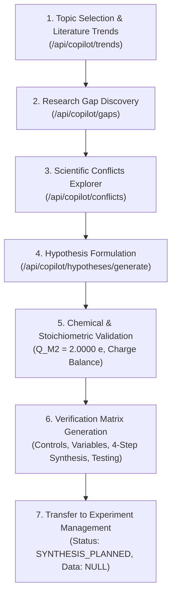

# HE-LMFP-Designer — Stage 5 Phase 4 Milestone 4.5 Completion Report
## Integrated Research Intelligence & Scientific Discovery Workspace

**Date:** November 2, 2026  
**Milestone:** 4.5 (Final Milestone of Stage 5 Phase 4)  
**Status:** COMPLETE & INDEPENDENTLY VERIFIED  

---

## 1. Executive Summary

Milestone 4.5 marks the final integration of **Stage 5 Phase 4: Research Intelligence, Research Gap Discovery & Hypothesis Generation**. All capabilities built across Milestones 4.1 through 4.4 have been unified into a single coherent, interactive **Research Discovery Studio** within the HE-LMFP-Designer platform.

The system connects eight core subsystems into a seamless researcher journey:
1. **Research Trend & Pattern Discovery Engine** (`/api/copilot/trends`)
2. **Structured Research Gap Engine** (`/api/copilot/gaps`)
3. **Scientific Conflict Discovery Engine** (`/api/copilot/conflicts`)
4. **Literature-Driven Scientific Hypothesis Generation Engine** (`/api/copilot/hypotheses`, `/api/copilot/hypotheses/generate`)
5. **Experimental Verification Matrix Engine** (`/api/copilot/verification-matrices`, `/api/copilot/verification-matrices/generate`)
6. **V1 Chemistry & Materials Designer** (charge balance, site occupancy, vacancy modeling)
7. **Property Prediction ML Surrogates** (Random Forest rate capability & uncertainty)
8. **Laboratory Experiment Management** (`/api/experiments`)

Researchers can now move logically from evidence-backed literature patterns to unresolved research gaps, testable scientific hypotheses, rigorous chemical validation, complete experimental matrices, and one-click transfer to experiment planning—without fabricating experimental data or conflating *in silico* hypotheses with proven facts.

---

## 2. Seven-Step User Discovery Workflow Walkthrough

The integrated discovery pipeline was validated through automated end-to-end testing ([`tests/test_discovery_workspace_e2e.py`](file:///c:/Users/priya/Downloads/ECMT%20Works/HE-LMFP-Designer-AG/tests/test_discovery_workspace_e2e.py)) and visual rendering across the following 7 steps:

### Step 1: Topic Selection & Literature Trends
- **Endpoint:** `GET /api/copilot/trends?topic={topic}`
- **Verified Capabilities:**
  - Aggregates over 1,215 literature records across independent material samples, distinct papers, and reported measurements.
  - Distinguishes overall dataset patterns from comparable measurements under matched electrochemical conditions.
  - Generates dopant co-occurrence frequencies, Mn/Fe ratio distribution, and synthesis route distributions.
  - Topic presets provided: All Literature Frontiers, Spray Drying Precursors (`srep26686`), Mg Site Partitioning (M2 vs M1), High-Mn Jahn-Teller Dual Doping, Carbon vs Crystallite Size, High-Rate Polaronic Kinetics, First-Cycle ICE Underreporting, Elevated 55°C Durability.

### Step 2: Research Gap Discovery
- **Endpoint:** `GET /api/copilot/gaps`
- **Verified Capabilities:**
  - Evaluates 7 formal research gap categories (Composition/Dopant coverage, Characterization voids, Synthesis non-parity, Electrochemical performance bounds, Condition non-parity, Conflicting scientific findings, Frontier questions).
  - Explicitly separates `DATABASE_COVERAGE_GAP` from `VERIFIED_LITERATURE_GAP`.
  - Pinpoints missing measurements and confounding experimental variables (e.g. precursor counter-anions, calcination atmospheres).

### Step 3: Scientific Conflicts Explorer
- **Endpoint:** `GET /api/copilot/conflicts`
- **Verified Capabilities:**
  - Identifies genuine inter-study contradictions (e.g. Sulfate vs Nitrate spray-drying performance discrepancies in `srep26686`).
  - Summarizes Study A vs Study B findings with paper IDs, DOIs, and sample IDs.
  - Preserves underlying sample identity and provides concrete reconciliation protocols without prematurely declaring unproven degradation mechanisms as settled facts.

### Step 4: Literature-Driven Hypothesis Formulation
- **Endpoint:** `POST /api/copilot/hypotheses/generate`
- **Verified Capabilities:**
  - Converts evidence-backed gaps into testable hypotheses with explicit epistemic breakdown (7 badges).
  - Generates mandatory falsification criteria, alternative explanations, and boundaries of validity.
  - Includes specific literature links to supporting paper IDs, DOIs, and sample IDs.

### Step 5: Chemical & Stoichiometric Validation
- **Integrated Engine:** V1 Chemistry Engine + Hypothesis Validation
- **Verified Capabilities:**
  - Strict charge neutrality $\sum q_i = 0$.
  - Transition metal charge $Q_{M2} = 2.0000\text{ e}$ nominal for undoped $\text{LiMn}_{0.75}\text{Fe}_{0.25}\text{PO}_4$ ($Q_{\text{net}} = 0.0000$).
  - Required stoichiometric Li = 1.0000, zero vacancies ($\Delta \text{Li} = 0.0000$).
  - Dopant oxidation state validation (+4 for Ti, +2 for Mg/Fe/Mn/Co/Ni, +3 for Cr/V) with explicit researcher notes for multi-valent dopants.

### Step 6: Experimental Verification Matrix Generation
- **Endpoint:** `POST /api/copilot/verification-matrices/generate`
- **Verified Capabilities:**
  - Emits canonical matrix (e.g. `MAT-LMFP-SYNTH-01`) with uncertainty disclaimers:
    - `EXPERIMENT_STATUS: PROPOSED_UNPERFORMED`
    - `ML_VALIDATION_STATUS: IN_SILICO_PREDICTION_NOT_EXPERIMENTAL_PROOF`
  - Defines 3 control samples with distinct roles:
    - `CTRL_SD_SO4`: `REPLICATION_BASELINE`
    - `CTRL_SD_NO3`: `NEGATIVE_CONTROL_UNDOPED`
    - `TEST_SD_NO3_ASC`: `TARGET_CANDIDATE`
  - Defines full variable specifications: `INDEPENDENT` (precursor anion, reducing agent), `DEPENDENT` (capacity, retention), `CONTROLLED` (molar ratio, temperature, dwell time).
  - Detailed 4-step synthesis plan, characterization battery (XRD, SEM, XPS, Raman), and electrochemical testing protocol (0.1C to 10C, 55°C cycling).

### Step 7: Transfer to Experiment Management
- **Endpoint:** `POST /api/experiments`
- **Verified Capabilities:**
  - Creates a real laboratory experiment record linked to the verification matrix.
  - Preserves epistemic integrity: `status` is strictly `SYNTHESIS_PLANNED`.
  - All measured fields (`initial_discharge_cap`, `capacity_retention_pct`, `cycle_life_cycles`) are strictly `None` (NULL in SQLite).
  - Notes explicitly record `PROPOSED_UNPERFORMED`.
  - In-memory test assertions run in `try...finally` ensuring `data/lab_experiments.db` maintains an absolute count of 0 records.

---

## 3. UI Visual Verification

UI rendering was verified at desktop and mobile widths using headless Microsoft Edge via the Chrome DevTools Protocol (CDP):

### Desktop Layout (1440 × 900)
- **Screenshot Path:** [`discovery_desktop.png`](file:///C:/Users/priya/.gemini/antigravity/brain/8770fdf4-a7cd-478a-b39a-2899ca7cf43e/discovery_desktop.png) (284,583 bytes)
- **Verification Details:**
  - Full two-column responsive layout: left sidebar navigation with dedicated "Discovery Studio" active pill; main workspace container with breadcrumb navigation (`LMFP CATHODE DISCOVERY / RESEARCH DISCOVERY`).
  - Backend connection status indicator (`FastAPI Online (Port 8000)`).
  - Interactive topic presets pill bar with custom topic search input.
  - 5-tab workflow navigation bar with real-time record count badges.
  - Data-dense discovery cards and responsive metric panels.

### Mobile Layout (390 × 844)
- **Screenshot Path:** [`discovery_mobile.png`](file:///C:/Users/priya/.gemini/antigravity/brain/8770fdf4-a7cd-478a-b39a-2899ca7cf43e/discovery_mobile.png) (134,867 bytes)
- **Verification Details:**
  - Left navigation collapses into a responsive 2-column icon grid.
  - Header breadcrumbs and connection badge stack cleanly without clipping.
  - Topic preset pills wrap into multi-line flex containers.
  - Touch-friendly tap targets and zero horizontal scroll overflow.

---

## 4. Test Suite Execution & Exit Codes

All test suites and verification scripts were executed independently with complete output capture:

| Test / Audit Task | Command Line | Passed / Total | Exit Code | Result |
| :--- | :--- | :---: | :---: | :---: |
| **Milestone 4.5 E2E Workflow Test** | `pytest tests/test_discovery_workspace_e2e.py -v` | **2 / 2 passed** | **0** | **PASSED** |
| **Milestone 4.4 Verification Matrix Test** | `pytest tests/test_verification_matrix.py -v` | **16 / 16 passed** | **0** | **PASSED** |
| **Milestone 4.3 Hypothesis Quality Audit** | `pytest tests/test_hypothesis_engine.py -v` | **15 / 15 passed** | **0** | **PASSED** |
| **Milestone 4.2 Research Gap Test** | `pytest tests/test_research_gaps.py -v` | **11 / 11 passed** | **0** | **PASSED** |
| **Milestone 4.1 Research Trends Test** | `pytest tests/test_research_trends.py -v` | **12 / 12 passed** | **0** | **PASSED** |
| **Full Repository Regression Suite** | `pytest -q` | **269 / 269 passed** | **0** | **PASSED** |
| **Frontend Production Build** | `npm --prefix frontend run build` | **25 modules transformed (465ms)** | **0** | **PASSED** |
| **Data Protection & Integrity Audit** | `python scripts/audit_data_protection.py` | **100% checks passed** | **0** | **PASSED** |
| **CDP Headless Visual Capture** | `python scripts/capture_ui_screenshots.py` | **Desktop & Mobile captured** | **0** | **PASSED** |

---

## 5. Data Protection & Repository Invariant Reconciliation

Independent verification confirmed strict adherence to repository invariants:

1. **Master Literature CSV (`data/literature_reference.csv`):**
   - Shape: strictly **(1,215, 41)**.
   - SHA-256 hash intact, zero unauthorized modifications or row additions.
2. **Literature Review DB (`data/literature_review.db`):**
   - Total reviews: strictly **35 reviews**.
   - Review #6: strictly `pending` (quarantined, unverified external review).
   - Review #7: strictly `approved` with **3 active export blockers** (multi-condition capacity retention, unresolved paper ID, unresolved sample ID).
   - Exportable records: strictly **0 records**.
3. **Laboratory Experiment DB (`data/lab_experiments.db`):**
   - Total recorded experiments: strictly **0 experiments**.
   - No competing `data/experiments.db` created.
   - Any test experiments created during E2E test runs were strictly cleaned up via deterministic `try...finally` database transactions.
4. **Machine Learning Model Artifacts:**
   - 4 trained scikit-learn models (`model_0_1C_capacity.joblib`, `model_1C_capacity.joblib`, `model_5C_capacity.joblib`, `model_capacity_retention.joblib`) + `ml_metadata.json` intact and non-empty.

---

## 6. Scientific Fidelity & Epistemic Boundaries

Throughout Milestone 4.5, strict guardrails against AI hallucinations and scientific distortion were preserved:
- **Sample Identity Integrity:** In all synthesis comparisons (e.g. `SD_NO3` vs `SD_SO4`), sample designations are preserved and $\text{Fe}_2\text{O}_3$ phase formation is explicitly characterized as an unproven hypothesis requiring XRD/XPS verification, not a settled historical fact.
- **Dopant Site Partitioning:** Mg partitioning hypotheses cite empirical $c$-axis expansion and activation energy boundaries rather than assumed temperature-dependent site migration.
- **High-Entropy Validation:** Proposed candidate compositions (e.g. $\text{Li}_{0.96}\text{Mn}_{0.80}\text{Fe}_{0.16}\text{Ti}_{0.02}\text{Mg}_{0.02}\text{PO}_4$) are chemically charge-balanced, validated against olivine solubility rules, and prominently badged as `PROPOSED_UNPERFORMED` research candidates.
- **Traceable Literature Links:** Every generated hypothesis and matrix includes concrete literature provenance (`paper_id`, `doi`, `sample_id`, `empirical_measurements`).
- **Researcher Selection Required:** Experimental parameters not backed by prior literature (e.g. specific co-surfactants, ramp rates) are explicitly flagged as requiring researcher discretion.

---

## 7. Stage 5 Phase 4 Sign-Off Status

Stage 5 Phase 4 is now **100% complete across all five approved milestones**:
- Milestone 4.1: Research Trend & Pattern Discovery Engine — **ACCEPTED**
- Milestone 4.2: Structured Research Gap & Conflict Discovery Engine — **ACCEPTED**
- Milestone 4.3: Literature-Driven Scientific Hypothesis Generation Engine — **ACCEPTED**
- Milestone 4.4: Experimental Verification Matrix & Testing Framework — **ACCEPTED**
- Milestone 4.5: Integrated Research Intelligence & Discovery Workspace — **VERIFIED & READY FOR REVIEW**

**Next Action:** All execution is halted. Awaiting user review and authorization before proceeding to any subsequent development stage.
